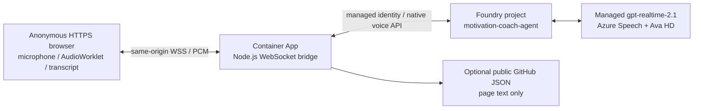

# Motivation Coach

A real-time voice AI companion that listens, reflects what it heard, and offers
a small moment of encouragement. Built by Vyom Nagrani with Microsoft Foundry,
Azure Container Apps, and a browser audio pipeline.

**Experimental AI, not therapy.** This bot is not a clinician, crisis counselor,
or substitute for qualified support. Its output is not medical or therapeutic
advice. In an emergency, contact local emergency services or a crisis service.

## What this showcases

- Native Foundry voice-agent sessions, not speech dictation glued to text chat.
- Streaming microphone input and spoken output: mono PCM16 at 24 kHz,
  browser AudioWorklets, resampling, live transcripts, and interruption handling.
- A same-origin WebSocket bridge that keeps Azure authentication on the server.
- Managed identity, project-scoped Foundry permissions, and passwordless image pull.
- A reproducible Bicep + Azure Developer CLI deployment, including the agent's
  instructions, greeting, Azure Speech transcription, semantic VAD, and Ava HD voice.
- Editable, text-only GitHub JSON for page copy without rebuilding the app.
- Bounded sessions, streaming queues, concurrency, and request rates.



## Deploy from scratch

Install [Azure Developer CLI](https://aka.ms/azure-dev/install),
[Azure CLI](https://aka.ms/installazurecli), [Node.js 22+](https://nodejs.org/),
and [PowerShell 7](https://learn.microsoft.com/powershell/scripting/install/installing-powershell).
PowerShell 7 is required on Windows, macOS, and Linux for the lifecycle hooks.
Container builds run remotely in ACR; a local Docker daemon is not normally
required. Your subscription must permit ACR Tasks; if remote builds are
unavailable, azd may require Docker for its local-build fallback.

You need an Azure subscription with billing enabled and permission to create
resource groups/resources and role assignments: **Owner**, or **Contributor**
plus **Role Based Access Control Administrator**, scoped appropriately.
Sign into the **same subscription/tenant and identity** in `az` and `azd`.

```powershell
git clone https://github.com/vyomnagrani/motivation-coach.git
cd motivation-coach
az login
azd auth login
azd up
```

Choose an environment name such as `demo`, your subscription, and an ACA-supported
location. The Foundry resource defaults separately to **East US**, the region
used by the source application. Native voice agents are preview: your subscription
must have access to the selected managed model and voice feature in that region.
Service availability, preview enrollment, quota, Azure Policy, and regional
capacity can prevent deployment even when the template is valid.

The managed model does **not** require a separate Azure OpenAI model deployment
or Speech resource. Managed voice/model usage is billed by the voice-agent service.
The unsuffixed `gpt-realtime-2.1` uses global processing; selecting an East US
account does not guarantee US-only inference. Consult the current
[voice-agent regions](https://learn.microsoft.com/azure/ai-foundry/agents/concepts/limits-quotas-regions)
and [model regions](https://learn.microsoft.com/azure/ai-services/speech-service/regions?tabs=voice-live)
before choosing a different Foundry region.

The deployment provisions new resources, creates/reuses the agent definition,
pins its returned version, builds the image, and prints `WEB_URL`. Open that
HTTPS URL, select **Start conversation**, and allow microphone access.
There is no visitor login.

The postdeploy hook records the actual image as `MOTIVATION_COACH_IMAGE` so a
later `azd provision` preserves it rather than reverting to the bootstrap image.

### Resources and names

Names use a `motivation-coach` theme with a deterministic uniqueness suffix
derived from your subscription, environment, and region. They do not reuse
the author's Azure account, subscription, registry, project, or app.

| Resource | Naming pattern |
|---|---|
| Resource group | `rg-motivation-coach-<environment>` |
| Container Apps environment | `cae-motivation-coach-<suffix>` |
| Container App | `ca-motivation-coach-<suffix>` |
| Foundry account | `ai-motivation-coach-<suffix>` |
| Foundry project | `motivation-coach-project` |
| Foundry voice agent | `motivation-coach-agent` |
| Runtime identity | `id-motivation-coach-<suffix>` |
| Container registry | `acrmotivation<suffix>` |
| Log Analytics | `log-motivation-coach-<suffix>` |

The reusable template creates a **standard ACA Consumption environment**,
not an Express environment. The original demo used an existing Express
environment; standard ACA makes new deployments compatible with the normal
`azd` Container Apps workflow.

## Configuration and customization

Edit `agent/definition.json` to change the coach's instructions, greeting, voice,
or audio settings. It is a native **`kind: voice`, `model_type: managed`** agent,
not a hosted container agent or legacy Voice Live text-agent integration.
The definition includes no tools, connections, stored conversations, or secrets.
Keep the listening-only, medical-advice, and crisis boundaries in place.

The original instructions describe a phone-call-like audio interaction.
They are preserved here, although this app transports audio through a browser.
Model and voice changes must be supported by the native voice-agent service;
they are not arbitrary Azure OpenAI deployment names.

`azd provision` registers the definition through the official SDK and native
voice preview header. It reuses a matching immutable version if one exists;
otherwise it creates a version and updates the app's pinned version.
`azd deploy` alone rebuilds the app; it does not change agent instructions.

```powershell
# Before provisioning: override Foundry region if your feature access requires it.
azd env set FOUNDRY_LOCATION eastus
# After changing agent/definition.json:
azd provision
azd deploy
# After changing application code:
azd deploy
# Equivalent PowerShell convenience wrapper:
.\scripts\deploy.ps1 -Stage Up
```

`PUBLIC_ORIGIN` is set to the actual HTTPS FQDN, not a guessed domain.
The runtime identity has **Foundry User only at project scope**. The app's
system-assigned identity has **AcrPull only at registry scope** for azd's image
deployment workflow. The deployment caller also receives project-scoped
Foundry User to create/read versions. No API keys, registry passwords, or client
secrets are required. Local Azure authentication state stays outside Git.

### Change page text without a rebuild

Fork the repo and edit `dynamic-content/foundryvoiceapp.json`. Connect your
deployment to your fork's **public** raw JSON URL:

```powershell
azd env set CONTENT_SOURCE_URL https://raw.githubusercontent.com/YOUR-USER/motivation-coach/main/dynamic-content/foundryvoiceapp.json
azd provision
azd deploy
```

That source configuration change is one-time. Later JSON edits committed to
the configured branch appear on new page loads without deploying. GitHub
caching may delay updates a few minutes; already-open pages do not auto-refresh.
Default deployments use bundled wording and do not fetch the author's repository.

Keep all five fields: `title` (160 characters), `tagline` (300), `heading` (300),
`introduction` (2000), and `disclaimer` (1000). Only nonempty strings are accepted.
Content is rendered using `textContent`, not HTML or scripts. Upstream fetches
are limited to five seconds and 16 KiB. Invalid/unavailable content produces
a visible notice and logged diagnostic while retaining bundled wording.
Page copy does not alter the agent's instructions or voice behavior.

## Local development

Deploy once or supply an existing native voice project and agent. The app
requires a real Foundry voice endpoint; it does not emulate one.

```powershell
cd src/web
npm ci
Copy-Item .env.example .env
# Edit .env: project endpoint, agent name/version, AZURE_AUTH_MODE=azure-cli.
# Use PUBLIC_ORIGIN=http://localhost:8080 for local development.
az login
npm start
```

Do not commit `.env`, `.azure`, credentials, recordings, or conversation data.
Production rejects Azure CLI authentication and uses the attached runtime identity.

## Safety, privacy, and costs

This is an **anonymous public demo**, not a production mental-health product.
Anyone who knows the URL can use it and incur charges. Five-minute sessions,
three concurrent sessions per process, and 3 starts/minute plus 10/hour per
client address provide friction, **not a hard spending cap**. The template
limits replicas to one and allows scale-to-zero; restarts reset in-memory limits.

Forwarded IP headers are ignored unless the immediate proxy is explicitly
trusted. Behind shared ACA ingress, visitors may share a rate-limit key.
Do not blindly trust all proxy addresses to bypass this limitation.

The app uses `store: false`, does not save recordings, and keeps the transcript
in page memory. Audio goes to Microsoft Foundry; provider-side processing and
logging may still apply. Infrastructure diagnostic logs are not conversation
recordings. Do not share sensitive information or connect private tools/data
to an anonymously accessible agent.

You pay for model/audio use, ACA, ACR, and Log Analytics as applicable. Review
Azure pricing, set budgets/alerts, and stop exposing the app when not needed.
Budget alerts do not automatically stop spending.

```powershell
# Destructive: deletes this azd environment's resource group and its resources.
azd down
```

## Validation and troubleshooting

```powershell
npm ci --prefix src/web
cd src/web
npm test
npm run check
cd ../..
node --test test/*.test.mjs
pwsh -File test/lifecycle.test.ps1
az bicep build --file infra/main.bicep --stdout
```

The postdeploy hook opens one anonymous native session and ends it cleanly.
This can incur a small model/audio charge if the agent greets the caller.
Human microphone, speaker quality, and barge-in still need a real browser test.
Do not continuously probe sessions: probes consume the public start-rate limit.

The source application has been exercised against a real native voice agent.
This extracted fresh-resource template has local/preflight validation only;
no separate fresh `azd up` deployment was performed before publication.
The GitHub workflow checks application tests, script syntax, and Bicep compilation
without cloud credentials; it is not an Azure deployment workflow.

If agent creation returns 403, hooks wait for project RBAC propagation, then
surface the error rather than broadening permissions. If voice access is denied
or a model is unavailable, check subscription feature access and supported
Foundry regions. Private network policies can block this public demo architecture.
For image-pull failures, check the app system identity's registry-scoped AcrPull
role and ACR ARM-token authentication. Inspect Container Apps logs for startup
errors, and ensure the app's `PUBLIC_ORIGIN` matches its external FQDN.

## Repository layout

| Path | Purpose |
|---|---|
| `src/web` | Browser UI, Node.js bridge, container, tests and smoke scripts |
| `agent/definition.json` | Sanitized, reproducible native voice-agent definition |
| `dynamic-content/foundryvoiceapp.json` | Optional externally editable UI text |
| `infra` | Subscription-scoped Bicep and resource modules |
| `scripts` | azd lifecycle hooks and deployment wrapper |
| `.github/workflows/validate.yml` | Credential-free CI |

## References and license

- [Native voice-agent quickstart](https://learn.microsoft.com/azure/foundry/agents/quickstarts/prompt-voice-agent)
- [Foundry realtime JavaScript sample](https://github.com/microsoft-foundry/foundry-samples/tree/main/samples/javascript/voice-agents/realtime-audio)
- [Azure Developer CLI](https://learn.microsoft.com/azure/developer/azure-developer-cli/)
- [Managed identity in Container Apps](https://learn.microsoft.com/azure/container-apps/managed-identity)

MIT licensed. Application code is original, informed by Microsoft's documented
native voice SDK/sample contracts. Microsoft SDKs and dependencies retain their
respective copyright notices and licenses; see `LICENSE` and `NOTICE`.
